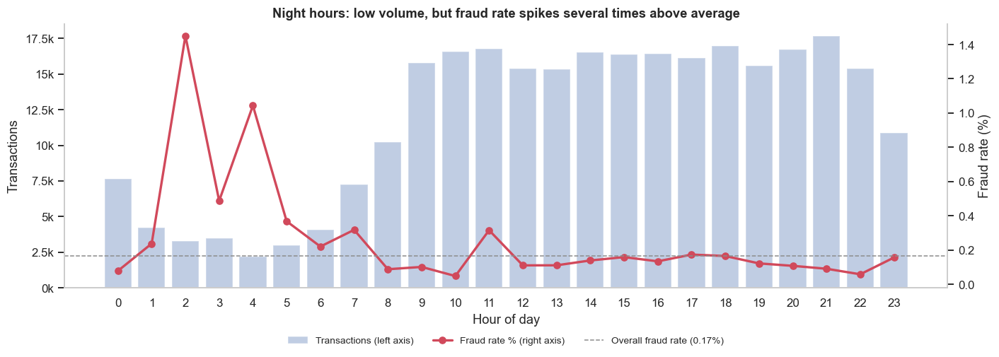
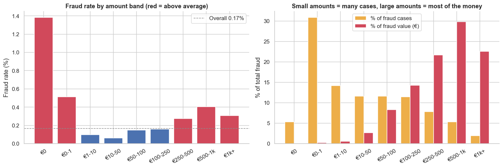
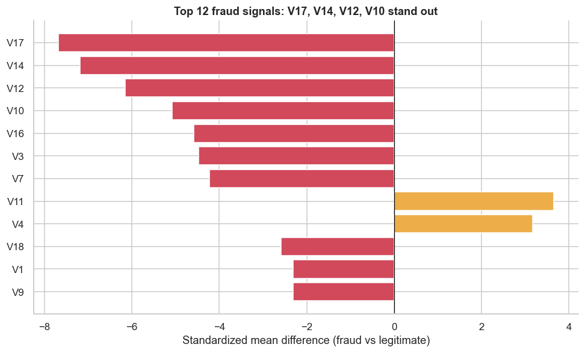
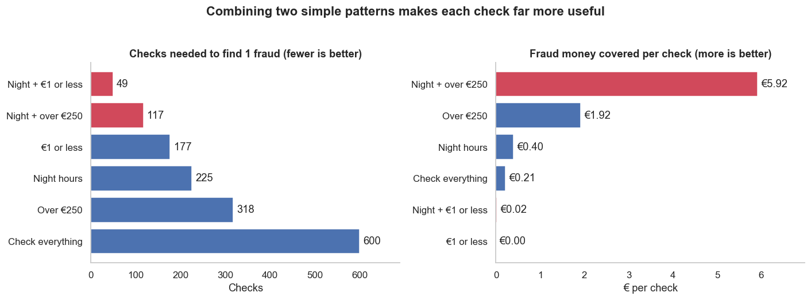

# Credit Card Fraud Analysis

When does card fraud happen, how much does it cost, and which simple alert rule should a fraud team start with? This project answers those questions using 283,726 real, anonymized card transactions.

**Tools:** Python (pandas, NumPy), SQL (SQLite), Matplotlib, Seaborn


## Key findings

- **Scale:** 473 transactions were fraud (0.167%), worth €58.6k over 2 days.
- **Timing:** hours 00–06 hold 10% of transactions but 26% of fraud. The fraud rate is 3.3× the rate at other hours.
- **Amounts:** most fraud is small, but most of the money is lost on large transactions. 36% of frauds are €1 or less, which is consistent with card testing. Transactions over €250 are 8% of volume but 74% of fraud losses.
- **Signals:** four anonymized columns (V17, V14, V12, V10) differ between fraud and legitimate activity far more than amount or hour do.
- **Alert rules:** two simple rules beat checking everything. Night + €1 or less finds 1 fraud every 49 checks, compared with 1 in 600. Night + over €250 covers €5.92 of fraud per check, compared with €0.21.









## Business questions

1. How big is the fraud problem in volume, rate and money lost?
2. Do fraudulent transactions differ in amount?
3. When does fraud happen?
4. Which amount bands carry the highest risk and the biggest losses?
5. Which anonymized columns look most different for fraud?
6. A fraud team can't check every transaction. Which simple alert rule should it start with?

## Recommendations

1. Automatically flag two types of night payment: payments of €1 or less, which may be criminals testing stolen cards and payments over €250, where each flag covers the most fraud money. Don't block them automatically, because about 98–99% are genuine. Test asking customers to confirm them, with analysts reviewing suspicious cases.
2. Test tighter controls overnight and measure the effect before rolling them out.
3. Treat transactions of €1 or less as a possible card-testing warning and monitor the card for follow-up attempts.
4. Put high-value alerts first in the analyst queue.

## Data

The data is the [Credit Card Fraud Detection dataset](https://www.kaggle.com/datasets/mlg-ulb/creditcardfraud) from Kaggle (Machine Learning Group, ULB). It covers 2 days of transactions by European cardholders in September 2013.

- **Rows:** 284,807 raw rows, or 283,726 after removing 1,081 exact duplicates.
- **Columns:** `Time`, `Amount`, `Class` (1 = fraud) and `V1`–`V28`, which are anonymized.


## Method

1. **Data quality:** checked for missing values, duplicates, negative amounts and zero-value transactions.
2. **Feature engineering:** derived the hour, day and amount band of each transaction.
3. **Exploratory analysis:** calculated KPIs and compared fraud by hour, amount band and anonymized column.
4. **SQL:** answered the core questions again in SQL, using CTEs and window functions.
5. **Rule testing:** used SQL to compare six simple alert rules on number of checks, frauds found and fraud money covered.

## Limitations

- **Short window:** two days of data cannot show weekly or seasonal patterns.
- **Rules need more testing:** I tested these rules on only 2 days of data and one rule found just 12 frauds, so they need testing on new data. They also miss most fraud.
- **Clock time is inferred:** `Time` counts seconds from the first transaction and the dataset does not give the clock time of that transaction. The "night" findings assume the recording starts near midnight, because the number of transactions falls sharply overnight.
- **Limited fields:** the data has no merchant, country or channel, and `V1`–`V28` can't be interpreted in business terms.
- **Currency:** the dataset does not state one. Amounts are shown in € because the cardholders were European.

## Repository structure

```text
├── credit_card_fraud_analysis.ipynb   # Full analysis, with outputs
├── figures/                           # Charts used in the analysis
├── outputs/                           # Summary tables for Tableau, Power BI or Excel
├── requirements.txt
└── README.md
```

